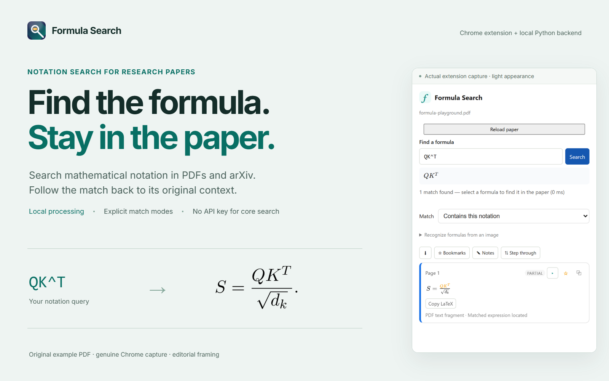
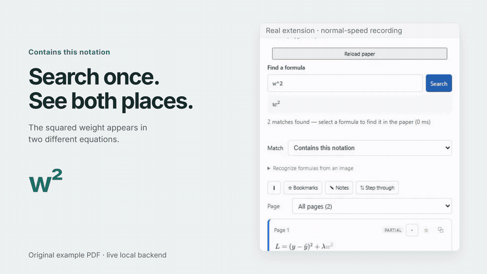
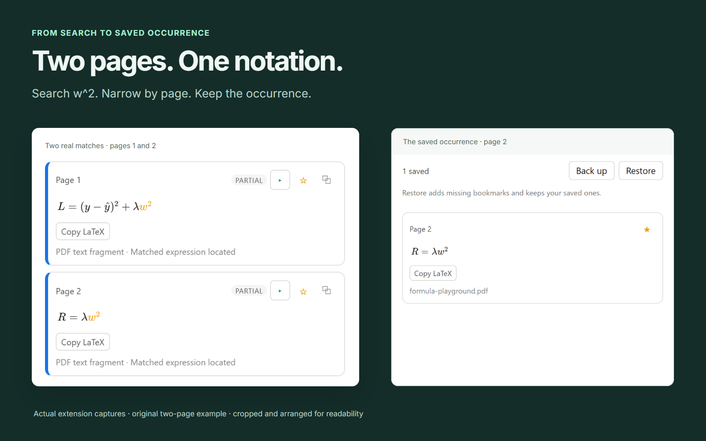
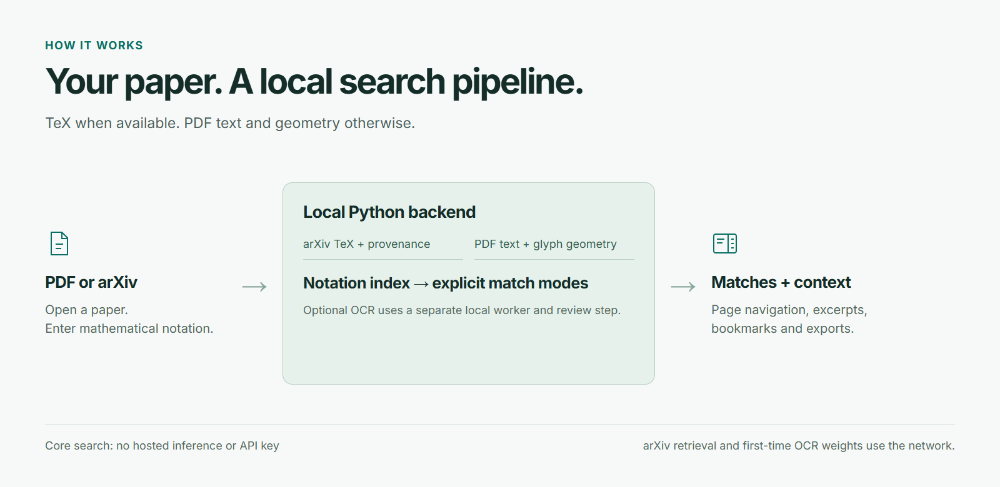

# Formula Search

**Find the formula. Stay in the paper.**

A Chrome extension for searching mathematical notation in **PDFs and arXiv
papers**, powered by a local Python backend. Search `QK^T`, `\frac{a}{b}`, or
`\mathbb{R}^N`, inspect the original context, and keep the occurrences you need.
Core search needs **no API key or machine-learning model**.

[Get started](#get-started-windows) · [User guide](docs/USAGE.md) ·
[Demo & gallery](docs/MEDIA.md) · [Architecture](docs/ARCHITECTURE.md) ·
[Validation](docs/VALIDATION.md)



## See the workflow

[](docs/media/demo.mp4)

**[Watch the 32-second widescreen demo](docs/media/demo.mp4)** ·
[Uncut product recording](docs/media/walkthrough.mp4) ·
[Transcript and capture details](docs/MEDIA.md)

Type `w^2` → find two occurrences → filter to page 2 → save the occurrence →
inspect the original PDF excerpt. The edited demo uses real Chrome captures and
normal-speed product actions, with a held excerpt for reading. It is silent and
works without sound.

## Built for reading papers

| When you need to… | Formula Search helps you… |
| --- | --- |
| Find a subexpression | Search notation while preserving case, order, grouping, fractions, scripts, and supported mathematical fonts |
| Follow an arXiv formula | Prefer available TeX and retain source file, line, and context |
| Inspect a match | Keep results in the side panel, filter by page or source section, and open a highlighted PDF excerpt |
| Keep a useful occurrence | Copy LaTeX/Markdown, bookmark its location, write notes, back up bookmarks, or export JSON |
| Read a scanned equation | Use optional local OCR, then review and correct its LaTeX before saving |



## Choose the meaning of a match

| Mode | Meaning | Example |
| --- | --- | --- |
| Contains this notation | Includes this notation | `QK^T` inside a fraction |
| Same notation only | Same normalized notation | A subexpression alone does not match a larger equation |
| Algebraically equal (scalars) | Bounded symbolic equivalence | Expanded/factored scalar expressions |

Algebraic mode assumes **commuting scalars** and can report incomplete checks.
It is unsuitable for general matrix identities. Extraction and source-to-page
mapping are heuristic; unsupported notation and uncertain locations are possible.

## Get started (Windows)

Use **Python 3.14** and a recent desktop Chrome. Python 3.14 provides the worker
termination API needed for deadline recovery. From the project folder:

```powershell
py -3.14 -m venv .venv
.\.venv\Scripts\python -m pip install -r requirements.txt
.\start.ps1
```

Keep the terminal running. Open <http://127.0.0.1:7878/health>; expect
`"status": "ok"` and version `0.11.1`.

1. Open `chrome://extensions` and enable **Developer mode**.
2. Choose **Load unpacked** and select the project's **extension** folder.
3. Enable **Allow access to file URLs** in its details for local PDFs.
4. Open [the example PDF](examples/formula-playground.pdf) in Chrome, open Formula
   Search, enter `QK^T`, and press **Search**.
5. Choose **Keep open** for the side panel. Try `w^2` for matches on two pages,
   then save a bookmark or inspect an excerpt.

For arXiv, open an abstract or PDF tab and search. Network access fetches the
paper and available source. After installation, local PDF search needs no remote
inference service. Default backend: `http://localhost:7878`; change it in settings
if using another port. See [setup and troubleshooting](docs/SETUP.md).

## Browser compatibility

**Verified on Chrome 158 and Chromium 151.** Chrome 158 restricts internal PDF
frames: results navigate to the page, and the detail action opens a highlighted
excerpt from the original PDF. Compatible older Chromium retains native overlays.
Chrome's PDF viewer remains the reading surface. Browser updates need acceptance
checks. The demo uses the supported Chrome 158 path.

<details>
<summary><strong>Optional equation OCR setup</strong></summary>

### Recognize, review, then save

OCR uses a separate **Python 3.12** environment. With [uv](https://docs.astral.sh/uv/):

```powershell
uv venv --seed --python 3.12 .venv-ocr
.\.venv-ocr\Scripts\python -m pip install -r requirements-ocr.txt
```

Restart the backend. The first recognition downloads weights. Select one equation,
recognize it, compare the editable LaTeX with the crop, correct errors, then save.
Added equations live in the current backend session; export or bookmark findings
you want to retain. [Detailed setup](docs/SETUP.md#optional-ocr).

</details>

## Development

```powershell
.\.venv\Scripts\python -m pip install -r requirements-dev.txt
.\.venv\Scripts\python -m pytest -q
.\.venv\Scripts\python tools/check_extension.py
```

Extension checks also need **Node.js 24** on `PATH`. External paper fixtures are
downloaded separately; missing paper-dependent tests report skips.
[CONTRIBUTING.md](CONTRIBUTING.md) covers paper gates, browser tests, and releases.
[Validation](docs/VALIDATION.md) distinguishes historical corpus results from
checks rerun for this publication snapshot.

```text
backend/       FastAPI, extraction, matching, workers and caches
extension/     Chrome MV3 panel, popup, storage and PDF navigation
examples/      Original two-page PDF and editable TeX
tests/        Python regressions
tests_js/     Node and embedded-JavaScript regressions
docs/         User, developer, validation and media guides
tools/        Checks, demo capture, corpus restoration, packaging
```

## Your paper, processed locally



PDF processing and optional OCR run in your configured backend, locally by default.
Chrome local storage holds history, bookmarks, settings, and notes. There is no
analytics integration or hosted account. arXiv fetches and first-time model
installation use the network. A custom backend receives your documents and
queries. See [privacy and permission details](docs/PRIVACY.md).

For extraction, worker recovery, caches, and the Chrome navigation boundary,
read the [architecture guide](docs/ARCHITECTURE.md).

## License and acknowledgments

Original code is [MIT licensed](LICENSE). Dependencies retain their terms:
**PyMuPDF/MuPDF is AGPL or commercially licensed**. MIT is not a blanket license
for the complete dependency stack. Read [third-party notices](THIRD_PARTY_NOTICES.md)
before redistributing or deploying a combined application.

Previews use [KaTeX](https://github.com/KaTeX/KaTeX), PDF processing uses
[PyMuPDF](https://github.com/pymupdf/PyMuPDF), and optional recognition uses
[pix2tex / LaTeX-OCR](https://github.com/lukas-blecher/LaTeX-OCR).
