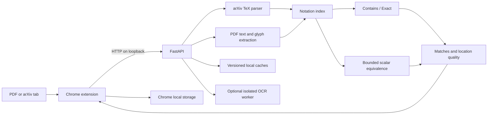

# Architecture

A Chrome Manifest V3 extension supplies the popup and side panel. A loopback
FastAPI service prepares documents, indexes candidates, searches, renders excerpts,
and coordinates optional recognition. A service worker coordinates browser storage
and document navigation.

## Search and mapping

arXiv prefers TeX candidates with provenance. Other PDFs use PyMuPDF text, font,
and geometry evidence. Notation search preserves supported structural distinctions.
SymPy is used only for explicit scalar algebra, in a bounded subprocess.

PDF mapping is lazy for matched source candidates. Source retrieval can succeed
when a PDF location remains uncertain. Multi-line grouping, script and font
geometry, sections, and prose exclusions contribute evidence. An increase in
mapped rectangles alone is not evidence of correctness.

## Concurrency and state

Requests for the same document can share preparation. Session generations prevent
older work from replacing newer state. PDF processing uses spawned workers,
bounded admission, and deadlines; Python 3.14 supports terminating workers during
recovery. Artifact, line, and candidate caches are versioned and bounded.

The extension serializes storage mutations through one writer. Document identity
and occurrence identity are distinct, so identical formulas at different locations
can be bookmarked separately. Older search responses cannot replace newer queries.

OCR runs in a separate Python 3.12 interpreter with a reusable model worker.
Proposal lifetime and crop dimensions are limited. Reviewed saves retain
server-owned geometry. Indexed OCR additions have backend-session lifetime;
bookmarks and notes have Chrome-storage lifetime.

## Browser boundary

Chrome 158 restricts internal PDF frames. The supported path uses page URLs and
backend-rendered excerpts. Compatible older Chromium can use native overlays.
Chrome's PDF viewer remains the reading surface. The unused earlier PDF.js
viewer is excluded from the public package.

| Responsibility | Main code |
| --- | --- |
| API and session lifecycle | `backend/main.py`, `sessions.py`, `preparations.py` |
| Worker limits and recovery | `backend/processing.py`, `matcher/worker_pool.py` |
| Source parsing/mapping | `backend/extractor/arxiv_tex.py`, `tex_*.py` |
| PDF reconstruction | `backend/extractor/text_layer.py`, `pdf_*.py` |
| Matching and identity | `backend/matcher/notation.py`, `fuzzy.py`, `occurrence.py` |
| Caches | `backend/cache.py`, `artifacts.py`, `line_index_cache.py` |
| OCR | `backend/ocr_runtime.py`, `ocr_worker.py`, `extractor/ocr_page.py` |
| Popup/panel | `extension/popup/` |
| Storage | `extension/shared-store.js`, `document-identity.js`, `bookmark-*.js` |
| PDF navigation | `extension/pdf-navigation.js`, `native-bridge.js`, `content.js` |

Before reloading the same PDF with a new page parameter, navigation waits for the requested URL to commit and finish loading. Chrome distinguishes a committed URL from its pending navigation; see the [Tabs API](https://developer.chrome.com/docs/extensions/reference/api/tabs#type-Tab). The wait is bounded and respects document cancellation.
