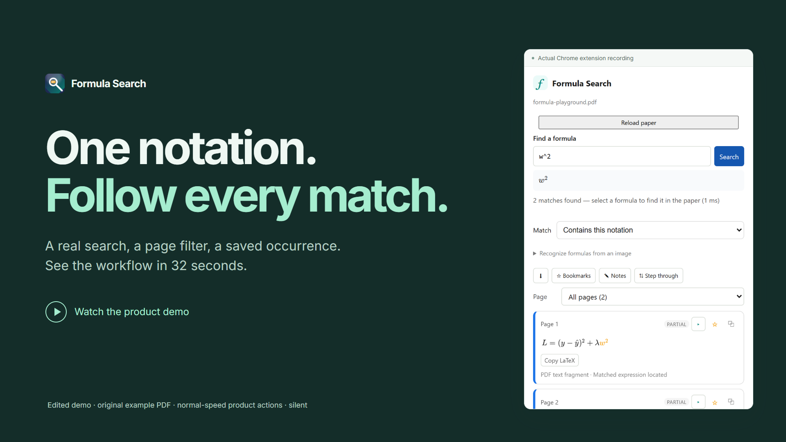
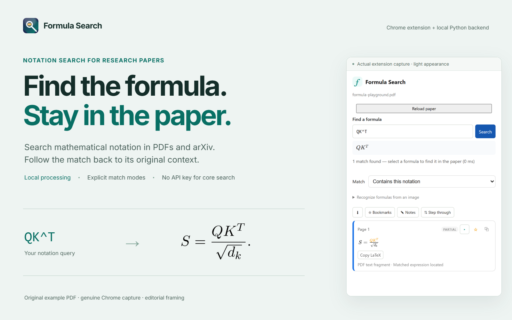
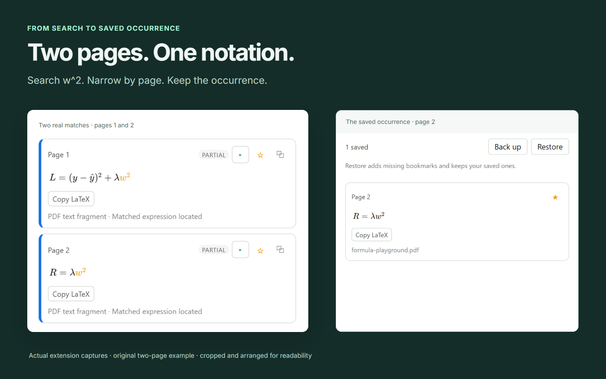
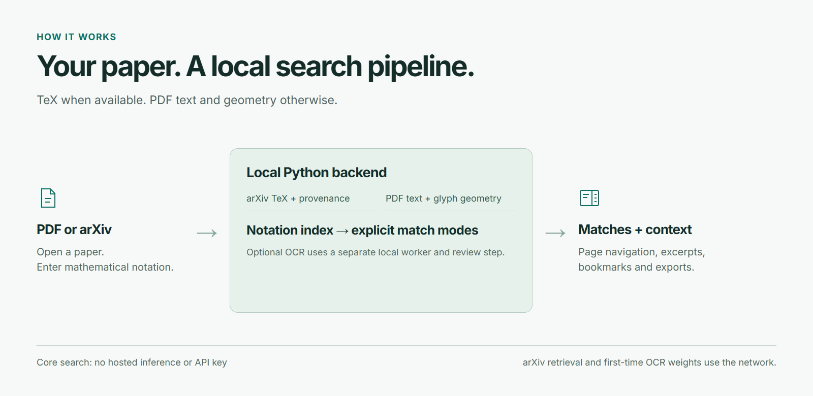

# Demo and visual guide

[](media/demo.mp4)

**[Watch the widescreen demo](media/demo.mp4)** ·
[Open the local gallery/player](presentation/review.html) ·
[English captions](media/demo.vtt) ·
[Uncut product recording](media/walkthrough.mp4)

The edited film is **1920 × 1080, 30 fps, 32 seconds**. It follows a real `w^2`
query through two results, a page filter, a saved occurrence, and an original-PDF
excerpt. It is designed for silent playback; all explanation is visible, and the
MP4 includes an optional English subtitle track. The README's lightweight GIF is
a preview linking to the full film.

## What is real, and what is edited

Product footage and screenshots come from **Chrome 158.0.8127.37**, the actual
extension, the actual local backend, and the original
[formula playground](../examples/formula-playground.pdf). Search results,
bookmarks, page navigation, and excerpt requests are unmocked. The capture script
asserts their results and checks for page/backend errors.

For repeatable capture, the panel UI is opened as an extension tab at **420 × 860
CSS pixels**, with **2× pixel density** for still images. Stills and video are
separate takes of the same asserted workflow; the video uses native pixel density
to avoid Chrome's inactive-tab screencast scaling issue. It is not an OS capture
of an attached Chrome side panel or a recording of opening the toolbar popup.
Chrome remains the PDF reading surface. No OCR or Chrome-158 in-viewer overlay
is demonstrated.

The widescreen film adds titles, trims, scene cuts, editorial close-ups, and camera
reframing. Product actions play at **normal speed**; the excerpt shot ends with a
deliberate freeze hold for reading. The uncut recording and its
[captions](media/walkthrough.vtt) remain available for comparison. Timing is a
demonstration, not a performance benchmark. The architecture illustration is a
conceptual diagram, not a product screen.

## Gallery







<details>
<summary><strong>Open individual, unframed product screenshots</strong></summary>

| Capture | What it shows |
| --- | --- |
| [Light search](media/search-light.png) | Numerator query and the actual PDF-text result |
| [Two pages](media/two-pages.png) | The squared weight in two equations |
| [Bookmarks](media/bookmarks.png) | The saved occurrence on page 2 |
| [PDF excerpt](media/pdf-excerpt.png) | The original-PDF excerpt and its highlighted region |
| [Native PDF](media/native-pdf.png) | Chrome's PDF reading surface |
| [Dark appearance](media/search-dark.png) | The actual dark theme |
| [Social preview](media/social-preview.png) | A 1280 × 640 title graphic with an original-PDF equation |

</details>

## Film transcript

| Time | What happens |
| --- | --- |
| 0–4 s | An equation from the original example introduces repeated notation |
| 4–7.5 s | A `w^2` search returns two occurrences, on pages 1 and 2 |
| 7.5–11 s | The page filter narrows the results to page 2 |
| 11–13.3 s | The saved occurrence appears in Bookmarks |
| 13.3–20 s | The original PDF excerpt is shown and Chrome navigates to page 2 |
| 20–26 s | Editorial close-ups show both actual results and the saved occurrence |
| 26–32 s | Actual dark appearance accompanies the project name and setup route |

The longer uncut recording also shows the earlier `QK^T` query and excerpt.
See [capture assertions and timestamps](media/capture.json) and the
[edit record](presentation/edit.json).

## Reproduce and edit

The [presentation project](presentation/README.md) includes editable HTML/CSS,
HyperFrames scenes, captured inputs, fonts and their license, source edit times,
the creative specification, and review notes. The static artwork is code-native;
the equations are high-resolution renders of the checked-in example PDF.
No generated mock interface is presented as a screenshot.

Install development dependencies and desktop Chrome. To rebuild artwork from the
supplied captures, from the project root:

```powershell
python tools/make_publication_graphics.py
```

For fresh screenshots and footage, use the separate still/video takes in the
[capture instructions](presentation/README.md#refresh-the-product-captures).
Each work directory must be new and contains an isolated profile, video, and cache.
Capture uses an ephemeral loopback backend and never changes the user's Chrome
profile. Refresh the edit times when recording a new take.

Original media follows the project's MIT license. Inter retains its
[SIL Open Font License](presentation/assets/fonts/OFL-inter.txt); dependency terms
are separate. [Media provenance](presentation/assets.json) records the inputs.
